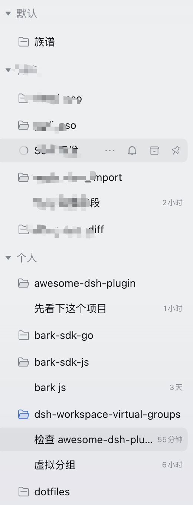
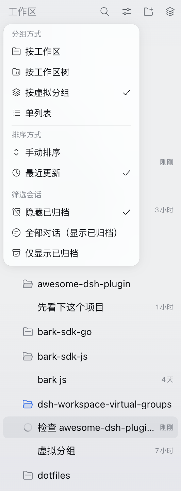
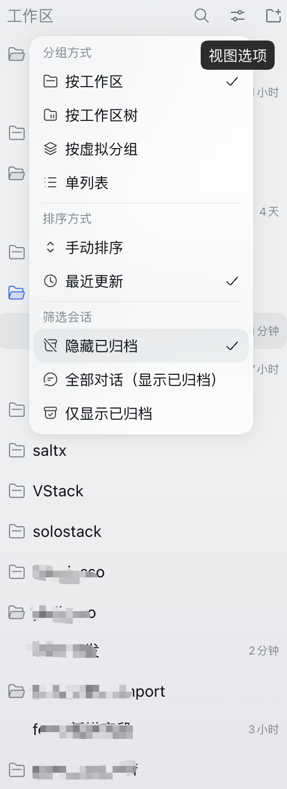

# @lkzc19/dsh-workspace-virtual-groups

给 DSH 侧边栏的工作区列表加一层手动虚拟分组。项目仍在原目录，插件只改变显示归属和顺序。



## 功能

- 内置「默认」分组固定第一，不可重命名、删除或拖动，但可以添加工作区和子分组。
- 分组可多层嵌套：拖分组标题到另一个分组中间即成为其子分组，拖到上/下缘则插入为同级。
- 项目行拖到分组标题上即可归组；分组与项目都按层级缩进，折叠父分组会收起整棵子树。
- 分组菜单：添加工作区、添加分组、重命名、删除。删除后组内项目与子分组上移到父分组。
- 「视图选项 → 分组方式」多一项「按虚拟分组」，选其他模式即回到官方分组。
- 分组与排序保存在插件自己的 JSON 中，不修改官方工作区数据。

| 「按虚拟分组」 | 切回官方分组 |
| --- | --- |
|  |  |

## 安装

```sh
dsh plugin --profile desktop add @lkzc19/dsh-workspace-virtual-groups
```

从源码安装（`lib/` 是构建产物，不入库）：

```sh
git clone https://github.com/lkzc19/dsh-workspace-virtual-groups.git
cd dsh-workspace-virtual-groups
npm install
dsh plugin --profile desktop add "$PWD"
```

安装后重启桌面端或对应的 `dsh web` 进程。git URL 直装不可用：pnpm 不对 git 依赖执行 `prepare`，拿到的源码没有 `lib/`。

卸载：

```sh
dsh plugin --profile desktop remove @lkzc19/dsh-workspace-virtual-groups
```

## 数据

```text
$DSH_HOME/workspace-virtual-groups.manual.json
```

## 许可证

MIT。基于 [z-col/dsh-workspace-groups](https://github.com/z-col/dsh-workspace-groups)（MIT）修改。完整许可见 [LICENSE](./LICENSE)。
